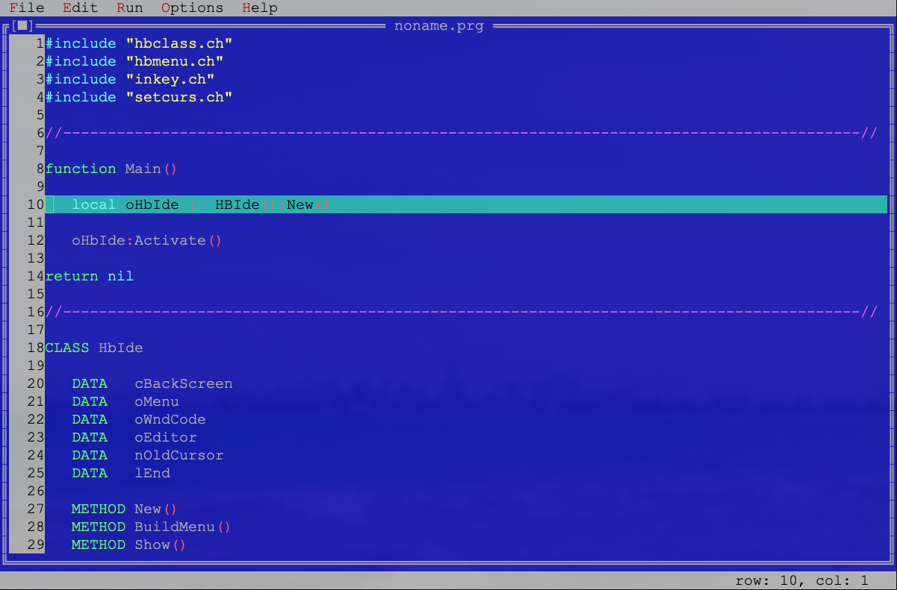

[](http://www.fivetechsoft.com "FiveTech Software")

# hbide - a text-mode IDE for Harbour

hbide is an IDE for the [Harbour](https://github.com/harbour/core) language
that runs in a terminal, in the style of the classic Borland Turbo Vision
IDEs: pull-down menus, windows, mouse support and dialogs with shadowed
buttons. It is written in Harbour itself.



## Features

- Code editor: syntax colouring, undo/redo, range selection, find and
  replace, goto line, word movement, insert/overwrite modes.
- Multiple documents: edit several files at once and switch with Ctrl+F6;
  each one keeps its own undo history, cursor, scroll, selection and
  breakpoints.
- Safe saving: atomic writes, .bak copies and detection of external changes
  or deletion of the file on disk.
- Crash recovery: unsaved buffers are journaled while you edit and offered
  back at the next start.
- Build and run from the IDE: Run > Start compiles the current file with
  hbmk2 and runs it only when the build really succeeded.
- Integrated Harbour source debugger: breakpoints (F9), stepping, watches,
  call stack, and back to the IDE with Alt+X.
- Projects: open .hbp files, build from the Sources/Build desktop and jump
  from each diagnostic to the failing line.
- Dialog designer: draw dialogs visually, save them as JSON and generate
  Harbour code. See [docs/designer.md](docs/designer.md).
- Context help: F1 on any menu option or in the editor; browsable manual
  with search under Help > Contents.

## Quick start

You need a Harbour build with `hbmk2` on your PATH.

```sh
git clone https://github.com/FiveTechSoft/hbide.git
cd hbide
hbmk2 hbide.hbp
./hbide        # hbide.exe on Windows
```

First steps inside the IDE: type some code, save with F2, build and run with
Run > Start, set a breakpoint with F9 and step through it with Run > Debug.
The full walkthrough is in [docs/quickstart.md](docs/quickstart.md).

A prebuilt `hbide.exe` for Windows is included, but it can lag behind the
sources; build from source for the latest state.

## Documentation

- [Quick start](docs/quickstart.md): from clone to your first debug session.
- [User guide](docs/user-guide.md): menus, keyboard shortcuts and features,
  with diagrams.
- [docs/](docs/README.md): feature and design notes (designer, debugger,
  help browser, projects, recovery) and the [roadmap](docs/ROADMAP.md).

## Status

hbide is in active development. The automated tests and the interactive
verification so far run on Linux; Windows validation of the latest sources
is still pending. Known limits are documented per feature in docs/.

## Acknowledgements

`hbdebug/` carries the Harbour source debugger, vendored from the Harbour
project (GPL v2 or later, with the Harbour runtime exception); see
[hbdebug/README.md](hbdebug/README.md).
